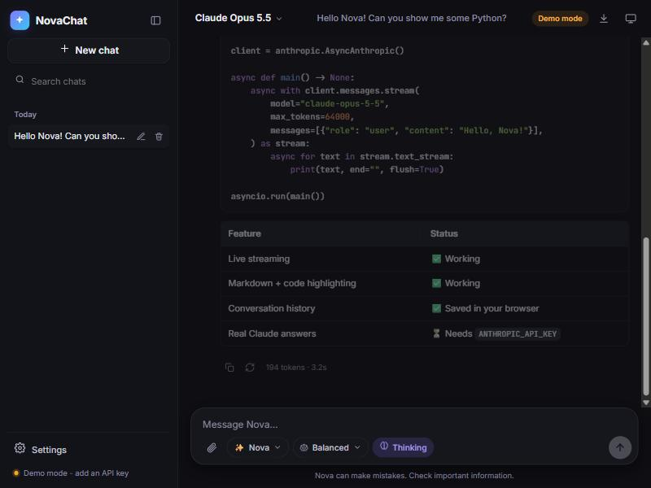
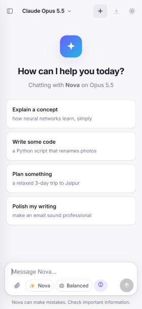

# ✨ NovaChat

**A real-time streaming AI chatbot website built with Python, FastAPI and Claude.**

Replies stream in live, token by token, into a polished chat interface with conversation
history, Markdown and code highlighting, image understanding, personas, a "thinking"
panel, dark mode and a mobile-friendly layout.

[](https://github.com/Insofury/nova-chat/actions/workflows/ci.yml)
[](https://render.com/deploy?repo=https://github.com/Insofury/nova-chat)

<table>
  <tr>
    <td width="72%"></td>
    <td></td>
  </tr>
</table>

---

## Features

| | |
|---|---|
| ⚡ **Live streaming** | Answers appear word by word over Server-Sent Events, with a Stop button (or `Esc`). |
| 🧠 **Claude models** | Claude Opus 5.5 (default), Sonnet 5.5 and Haiku 5.5, switchable from the header. |
| 🎚️ **Effort control** | *Fast*, *Balanced* or *Deep* thinking per message. |
| 💭 **Thinking panel** | A collapsible summary of the model's reasoning ("Thought for 4s"). |
| 🎭 **Personas** | Nova, Code Expert, Patient Tutor, Writing Coach and Analyst, plus your own custom instructions. |
| 🖼️ **Image understanding** | Attach, paste or drag-and-drop images; large ones are resized in the browser. |
| 📝 **Rich Markdown** | Headings, tables, lists, syntax-highlighted code with one-click copy. |
| 💬 **Chat history** | Saved in your browser (IndexedDB) with search, rename, delete and date groups. |
| ✏️ **Edit & regenerate** | Edit any message and resend, or regenerate the last reply. |
| 📤 **Export** | Download a chat as Markdown or all chats as JSON. |
| 🌗 **Themes** | Light, dark or follow the system. Fully responsive on phones. |
| 🛡️ **Production-ready** | Rate limiting, optional access code, security headers (CSP), request size limits, health check, Docker and CI. |
| 🧪 **Demo mode** | With no API key the site still works and streams a built-in demo reply. |

## Quick start (local)

Requires **Python 3.10+**.

```bash
git clone https://github.com/Insofury/nova-chat.git
cd nova-chat
python -m venv .venv
```

Activate the virtual environment, then install and run:

```bash
# Windows
.venv\Scripts\activate
# macOS / Linux
source .venv/bin/activate

pip install -r requirements.txt
cp .env.example .env        # then paste your ANTHROPIC_API_KEY into .env
python run.py
```

Open **http://localhost:8000**. Without an API key the app runs in demo mode.

Get an API key at [console.anthropic.com](https://console.anthropic.com).

## Deploy it live (free)

### Option 1 - Render (one click)

1. Click **Deploy to Render** above (sign in with GitHub).
2. When asked, paste your `ANTHROPIC_API_KEY` (leave it empty for demo mode).
3. Click **Apply**. In about two minutes your chatbot is live at `https://novachat-xxxx.onrender.com`.

Render reads [`render.yaml`](render.yaml), installs `requirements.txt` and starts Uvicorn.
Free instances sleep after 15 minutes of inactivity and wake on the next visit (~30 s).

### Option 2 - Any Docker host

```bash
docker build -t novachat .
docker run -p 8000:8000 -e ANTHROPIC_API_KEY=sk-ant-... -e TRUST_PROXY=true novachat
```

Works on Railway, Fly.io, Google Cloud Run, Hugging Face Spaces (Docker), Azure, etc.

## Configuration

All settings are environment variables (or lines in `.env`):

| Variable | Default | Description |
|---|---|---|
| `ANTHROPIC_API_KEY` | *(empty)* | Your Claude API key. Empty = demo mode. |
| `DEFAULT_MODEL` | `claude-opus-5-5` | `claude-opus-5-5`, `claude-sonnet-5-5` or `claude-haiku-5-5`. |
| `DEFAULT_EFFORT` | `medium` | `low`, `medium` or `high`. |
| `MAX_TOKENS` | `64000` | Max tokens per reply (thinking + answer). |
| `RATE_LIMIT_PER_MINUTE` | `20` | Chat requests per IP per minute. `0` disables. |
| `ACCESS_CODE` | *(empty)* | If set, visitors must enter this code to chat. |
| `TRUST_PROXY` | `false` | Set `true` behind a reverse proxy so the real client IP is used. |
| `APP_NAME` | `NovaChat` | Name shown in the API docs and settings. |

## Project structure

```
nova-chat/
├── app/                  Python backend (FastAPI)
│   ├── main.py           app factory, routes, static hosting
│   ├── config.py         settings + model catalogue
│   ├── llm.py            Claude streaming engine + demo engine
│   ├── chat.py           request validation -> Claude message format
│   ├── personas.py       personas + system prompt builder
│   ├── schemas.py        Pydantic request models
│   ├── sse.py            Server-Sent Events + keep-alive heartbeat
│   ├── rate_limit.py     sliding-window rate limiter
│   └── security.py       client IP, access code, security middleware
├── static/               the website (HTML/CSS/vanilla JS modules)
├── tests/                pytest suite (API + unit tests)
├── docs/PROJECT_NOTES.md full project notes and module-by-module guide
├── Dockerfile · render.yaml · Procfile · .github/workflows/ci.yml
└── requirements.txt · run.py · .env.example
```

📘 **Read [docs/PROJECT_NOTES.md](docs/PROJECT_NOTES.md)** for the full summary, architecture
diagrams, how streaming works, and what every module and function does.

## API

Interactive docs are served at **`/api/docs`**.

| Method | Path | Purpose |
|---|---|---|
| `GET` | `/api/health` | Health check (`{"status":"ok"}`) |
| `GET` | `/api/config` | Models, personas, efforts, limits, mode |
| `POST` | `/api/chat` | Streams the reply as Server-Sent Events |

```bash
curl -N http://localhost:8000/api/chat \
  -H "Content-Type: application/json" \
  -d '{"messages":[{"role":"user","content":"Hello!"}]}'
```

## Tests

```bash
pip install -r requirements-dev.txt
pytest -q
```

## Keyboard shortcuts

| Keys | Action |
|---|---|
| `Enter` / `Shift+Enter` | Send / new line |
| `Esc` | Stop the reply |
| `Ctrl+Shift+O` | New chat |
| `/` | Focus the message box |

## License

MIT - see [LICENSE](LICENSE).
