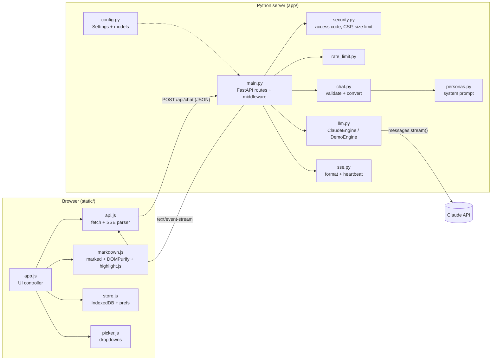
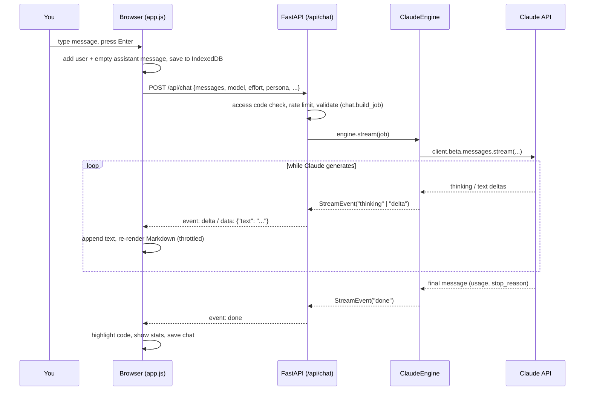

# NovaChat - Project Notes & Code Guide

These notes explain **what NovaChat is, how it works, and what every file and module
contains**. Read them top to bottom once, then use the module sections as a reference.

---

## 1. Summary

**NovaChat** is a full-stack AI chatbot website written in **Python**. A FastAPI server
hosts the website and an API; when you send a message, the server calls Anthropic's
**Claude** model with the official `anthropic` Python SDK and **streams the reply back
to the browser live**, token by token, using **Server-Sent Events (SSE)**.

| Item | Detail |
|---|---|
| Language | Python 3.10+ (backend), HTML/CSS/JavaScript (frontend, no build step) |
| Web framework | FastAPI + Uvicorn (async ASGI server) |
| AI model | Claude Opus 5.5 by default; Sonnet 5.5 and Haiku 5.5 selectable |
| AI SDK | `anthropic` (async client, streaming, adaptive thinking, prompt caching, refusal fallbacks) |
| Streaming | Server-Sent Events over a `POST` request, read with `fetch()` streams |
| Storage | Chats live in the user's browser (IndexedDB) - the server stores nothing |
| Hosting | Render (free, `render.yaml`), Docker anywhere, or any Python host (`Procfile`) |
| Tests | 33 pytest tests (API, validation, security, rate limit, SSE, Claude engine) |

### Highlights

- **Live responses** - text appears as Claude generates it; Stop at any time.
- **Thinking summary** - Claude's reasoning summary streams into a collapsible panel.
- **Model, effort and persona pickers**, plus user-defined custom instructions.
- **Vision** - attach/paste/drag images; the browser resizes big images before upload.
- **Rich rendering** - GitHub-flavoured Markdown, tables, highlighted code with Copy.
- **History** - searchable sidebar, rename, delete, edit-and-resend, regenerate, export.
- **Safe for the public internet** - per-IP rate limit, optional access code, strict
  Content-Security-Policy, HTML sanitising, request-size limit, non-root Docker image.
- **Demo mode** - with no API key, the site still streams a built-in reply, so a fresh
  deployment is never broken.

---

## 2. Architecture



### What happens when you press Send



**Key design decisions**

1. **The browser owns the conversation.** The Claude API is stateless, so each request
   sends the full history. Keeping history client-side means the server needs no
   database, scales trivially and never stores anyone's chats.
2. **Engines behind one interface.** `ClaudeEngine` and `DemoEngine` both yield
   `StreamEvent`s; the web layer never knows which one is running. Tests use a fake one.
3. **SSE over POST.** `EventSource` only supports GET, so the browser uses `fetch()` and
   parses the event stream itself (`api.js`). This lets us POST large JSON bodies.
4. **No front-end build step.** Plain ES modules served as static files - easy to read,
   easy to deploy.

---

## 3. Folder structure

```
nova-chat/
├── app/                       ← Python backend package
│   ├── __init__.py            version number
│   ├── main.py                FastAPI app factory, routes, middleware, static hosting
│   ├── config.py              Settings (env vars), model catalogue, effort levels
│   ├── llm.py                 ChatEngine protocol, ClaudeEngine, DemoEngine, error mapping
│   ├── chat.py                request validation and conversion to Claude's format
│   ├── personas.py            personas and system-prompt builder
│   ├── schemas.py             Pydantic models for the request body
│   ├── sse.py                 SSE formatting + keep-alive heartbeat
│   ├── rate_limit.py          in-memory sliding-window rate limiter
│   └── security.py            client IP, access code, security headers, body-size limit
├── static/                    ← the website
│   ├── index.html             page skeleton, dialogs, CDN scripts
│   ├── favicon.svg
│   ├── css/styles.css         design tokens, light/dark themes, layout, components
│   └── js/
│       ├── app.js             main UI controller (state, rendering, events)
│       ├── api.js             /api/config + streaming /api/chat client
│       ├── store.js           IndexedDB conversation store + localStorage prefs
│       ├── markdown.js        Markdown render, sanitise, highlight, copy buttons
│       ├── picker.js          reusable dropdown component
│       ├── icons.js           inline SVG icon set
│       └── theme-init.js      applies saved theme before first paint
├── tests/
│   ├── conftest.py            fixtures, fake engine, SSE parser
│   ├── test_api.py            HTTP-level tests for every endpoint and rule
│   └── test_units.py          unit tests: SSE, rate limiter, personas, config, Claude engine
├── docs/
│   ├── PROJECT_NOTES.md       this file
│   └── screenshots/
├── .github/workflows/ci.yml   GitHub Actions: run tests on Python 3.11-3.13
├── Dockerfile                 production container image
├── render.yaml                Render one-click deploy blueprint
├── Procfile                   start command for Heroku-style hosts
├── requirements.txt           runtime dependencies
├── requirements-dev.txt       + test dependencies
├── run.py                     `python run.py` local launcher (auto-reload)
├── .env.example               template for local configuration
└── README.md / LICENSE
```

---

## 4. Backend modules (`app/`)

### 4.1 `app/__init__.py`
Marks `app` as a Python package and defines `__version__ = "1.0.0"`, shown by
`/api/health`, `/api/config` and the API docs.

### 4.2 `app/config.py` - configuration
**Purpose:** one place for everything that changes between environments.

| Name | Kind | What it does |
|---|---|---|
| `PROJECT_ROOT`, `STATIC_DIR` | constants | Absolute paths, so the app works from any working directory. |
| `ModelInfo` | dataclass | `id`, `label`, `tagline`, `server_fallback` for each selectable model. |
| `MODELS`, `MODELS_BY_ID` | tuple / dict | The model catalogue: Opus 5.5, Sonnet 5.5, Haiku 5.5. |
| `EFFORT_LEVELS` | dict | `low → Fast`, `medium → Balanced`, `high → Deep`. |
| `load_dotenv()` | function | Tiny `.env` reader; real environment variables always win. |
| `_env_str/_env_int/_env_bool` | helpers | Safe parsing with defaults (bad values never crash startup). |
| `Settings` | frozen dataclass | All runtime settings + limits; `demo_mode` property; `from_env()` builder that validates model/effort. |

Limits live here too: max messages per chat (200), max characters per message (50,000),
max images per message (4), max image size (5 MB), max request body (25 MB).

### 4.3 `app/personas.py` - personas and the system prompt
**Purpose:** decide *how* the assistant should behave.

- `Persona` dataclass: `id`, `name`, `emoji`, `description`, `instructions`.
- `PERSONAS`: **Nova** (default), **Code Expert**, **Patient Tutor**, **Writing Coach**, **Analyst**.
- `BASE_PROMPT`: shared identity and formatting guidance (Markdown, code fences) plus today's date.
- `get_persona(id)`: returns the persona or falls back to Nova.
- `build_system_prompt(persona_id, custom_instructions, today)`: joins
  base prompt → `## Your role` (persona) → `## The user's custom instructions`.

The system prompt stays identical between turns of a chat, which lets **prompt caching**
reuse it cheaply.

### 4.4 `app/schemas.py` - request models
Pydantic models that FastAPI uses to parse and validate the JSON body automatically
(bad shapes return HTTP 422):

- `ImageAttachment` - `media_type` (png/jpeg/gif/webp only) and base64 `data`.
- `ChatMessage` - `role` (`user`/`assistant`), `content`, optional `images`.
- `ChatRequest` - `messages` (at least one), `model`, `effort`, `persona`,
  `custom_instructions`, `show_thinking`.

### 4.5 `app/chat.py` - validation and conversion
**Purpose:** turn a raw `ChatRequest` into a safe, ready-to-send `ChatJob`.

| Function | What it does |
|---|---|
| `ChatValidationError` | Exception for rule violations → HTTP 400 with a friendly message. |
| `_decoded_size(b64)` | Strictly decodes base64 and returns the byte size (rejects junk). |
| `to_api_message(msg)` | Converts one browser message to Claude format. Images become `{"type":"image","source":{"type":"base64",...}}` blocks followed by a text block. Empty messages are skipped. |
| `build_job(request, settings)` | Checks model, effort, message count, message length, custom-instruction length, image count/size/role; drops empty turns; ensures the conversation starts and ends with a user turn; builds the system prompt; returns a `ChatJob`. |

### 4.6 `app/llm.py` - the AI engines ⭐
**Purpose:** produce the assistant's reply as a stream of events.

| Name | What it is |
|---|---|
| `StreamEvent` | `event` name + `data` dict. Events: `start`, `thinking`, `delta`, `notice`, `done`, `error`. |
| `ChatJob` | Validated request: `model`, `system`, `messages`, `effort`, `show_thinking`. |
| `ChatEngine` | `Protocol` - anything with `name` and `stream(job)` is an engine. |
| `describe_api_error(exc)` | Maps SDK exceptions (most specific first) to `(code, friendly message)`: bad key, permission, not found, rate limited, bad request, overloaded/5xx, timeout, connection. |
| `ClaudeEngine` | The real engine (below). |
| `DemoEngine` | Streams a canned Markdown reply word by word when no key is set. |
| `create_engine(settings)` | Returns `ClaudeEngine` if `ANTHROPIC_API_KEY` is set, else `DemoEngine`. |

**How `ClaudeEngine` calls Claude** (`_request_params` + `stream`):

```python
async with client.beta.messages.stream(
    model="claude-opus-5-5",
    max_tokens=64000,
    system=system_prompt,
    messages=history,
    thinking={"type": "adaptive", "display": "summarized"},  # readable reasoning summary
    output_config={"effort": "medium"},                       # low | medium | high
    cache_control={"type": "ephemeral"},                      # automatic prompt caching
    betas=["server-side-fallback-2026-07-01"],
    fallbacks="default",                                      # see below
) as stream:
    async for event in stream:
        ...  # "thinking" -> thinking event, "text" -> delta event
    final = await stream.get_final_message()                 # usage + stop_reason
```

- **Adaptive thinking:** current Claude models always think; `effort` decides how much.
  `display: "summarized"` returns a readable summary, shown in the Thinking panel.
- **Prompt caching:** repeated conversation prefixes are billed at cache-read rates, so
  long chats get cheaper per turn.
- **Refusal fallbacks:** if a safety classifier declines a request, the API transparently
  re-runs it on a recommended fallback model in the same call. A `fallback` content block
  becomes a `notice` event and the UI shows *"Switched to … to finish this reply"*.
  Haiku 5.5 doesn't support this, so it is only sent for Opus/Sonnet.
- **Stop reasons:** `done` carries `stop_reason`; the UI explains `max_tokens`
  (cut off) and `refusal`.
- **Client disconnects:** if the user presses Stop, the async generator is cancelled,
  the `async with` block exits and the upstream HTTP stream to Claude is closed - you
  stop paying for tokens nobody will read.

### 4.7 `app/sse.py` - Server-Sent Events
- `format_sse(event, data)` → `"event: delta\ndata: {...}\n\n"` (compact JSON, one line).
- `with_heartbeat(source, interval=15)` - runs the event source in a background task and,
  whenever 15 s pass with no output (e.g. while the model thinks), emits a
  `: keep-alive` comment so proxies don't drop the connection. Errors are re-raised to the
  consumer; on disconnect the task is cancelled.

### 4.8 `app/rate_limit.py` - rate limiting
`SlidingWindowRateLimiter(limit, window_seconds)` keeps a deque of timestamps per client
key. `hit(key)` returns `(allowed, retry_after_seconds)`. Old entries expire as the
window slides; idle clients are swept periodically so memory stays bounded. `limit <= 0`
disables limiting. (In-memory = per process; use Redis if you run many instances.)

### 4.9 `app/security.py` - security helpers
| Name | Purpose |
|---|---|
| `client_ip(request, trust_proxy)` | Uses the first `X-Forwarded-For` IP only when `TRUST_PROXY=true`. |
| `access_code_ok(provided, expected)` | Constant-time (`hmac.compare_digest`) check of the optional access code. |
| `SecurityHeadersMiddleware` | Pure-ASGI (streaming-safe) middleware adding `Content-Security-Policy`, `X-Content-Type-Options`, `X-Frame-Options`, `Referrer-Policy`, `Permissions-Policy`. The CSP allows scripts only from this site and two CDNs and blocks inline scripts; Swagger UI paths are exempt. |
| `BodySizeLimitMiddleware` | Rejects requests whose `Content-Length` exceeds the limit with HTTP 413. |

### 4.10 `app/main.py` - the web application
`create_app(settings=None, engine=None)` is an **application factory**: production calls
it with no arguments (settings from env), tests pass their own settings and a fake engine.
It creates the rate limiter, the FastAPI app, adds middleware and registers routes:

| Route | Handler | Notes |
|---|---|---|
| `GET /api/health` | `health()` | `{"status":"ok","version":...,"mode":"claude"/"demo"}` for uptime checks. |
| `GET /api/config` | `config()` | Models, efforts, personas, defaults, limits, whether an access code is required. |
| `POST /api/chat` | `chat()` | Access code → rate limit → `build_job` → `StreamingResponse` of SSE (with heartbeat and no-buffering headers). |
| `GET/HEAD /` | `index()` | Serves `static/index.html` (no-cache). |
| `/static/*` | `StaticFiles` | CSS, JS, icons. |
| `GET /favicon.ico` | `favicon()` | Serves the SVG favicon. |
| `GET /api/docs` | built-in | Swagger UI to try the API. |

The module ends with `app = create_app()` - the object Uvicorn runs (`app.main:app`).

---

## 5. Frontend modules (`static/`)

### 5.1 `index.html`
The page skeleton: sidebar (brand, New chat, search, chat list, Settings, mode pill),
top bar (model picker, title, demo badge, export, theme), message list, composer
(attachments, textarea, attach button, persona/effort pickers, Thinking toggle, Send/Stop),
and `<dialog>`s for Settings, Access code and the image lightbox. Loads `marked`,
`DOMPurify` and `highlight.js` from CDNs (pinned versions) before `app.js`.

### 5.2 `css/styles.css`
- **Design tokens** on `:root` (colours, radii, shadows, syntax colours), redefined for
  dark mode via `prefers-color-scheme` and `[data-theme="dark"]`.
- Layout: CSS grid (`sidebar | main`), collapsible sidebar, off-canvas sidebar on phones.
- Components: buttons, pickers, chips, message bubbles, thinking panel (shimmer while
  live), typing dots, blinking cursor, code blocks, tables, empty state, composer,
  popover, dialogs, toasts. Respects `prefers-reduced-motion`.

### 5.3 `js/app.js` - main controller
Holds the app **state** (`config`, `conversations`, `activeId`, `streaming`,
`pendingImages`, `search`, `stickToBottom`) and does everything the user sees:

| Area | Functions |
|---|---|
| Startup | `init()` - loads config + IndexedDB in parallel, builds pickers, restores last chat, marks interrupted replies. |
| Sidebar | `renderSidebar()` (date groups + search), `startRename()`, `deleteConversation()`, `toggleSidebar()`. |
| Conversations | `newChat()`, `openConversation()`, `createConversation()`, `updateHeader()`. |
| Rendering | `renderMessages()`, `buildUserMessage()`, `buildAssistantMessage()`, `paintAssistant()` (thinking panel, Markdown body, cursor, notices, errors, stats), `scheduleRender()` (throttles redraws to ~25/s). |
| Sending | `send()` → `generate(conv)`: builds the payload with `historyFor()`, calls `streamChat()`, updates the message on each event, handles Stop/errors/401/413, saves the chat. |
| Editing | `stopStreaming()`, `regenerate()`, `startEdit()` (edit a message, drop later turns, resend). |
| Images | `addFiles()`, `prepareImage()` (resize to ≤1568 px, re-encode JPEG if large), `renderAttachments()`, `openLightbox()`. |
| Settings | `openSettings()`, `openAccessDialog()`, theme `applyTheme()/setTheme()`, `exportMarkdown()`, export-all JSON, delete-all. |
| Input | `bindEvents()` - Enter to send, paste & drag-drop images, shortcuts (`Esc`, `Ctrl+Shift+O`, `/`). |

### 5.4 `js/api.js`
- `fetchConfig()` - `GET /api/config`.
- `streamChat(payload, {signal, accessCode, onEvent})` - `POST /api/chat`, then reads
  `response.body` chunk by chunk, splits on blank lines, parses each SSE block
  (`parseEvent`) and calls `onEvent(type, data)`. `AbortController` powers the Stop button.
- `ApiError` - carries the HTTP status so the UI can react (401 → ask for access code).

### 5.5 `js/store.js`
- `ConversationStore` - IndexedDB wrapper (`init`, `list`, `put`, `delete`, `clear`) with
  an in-memory fallback when IndexedDB is unavailable (e.g. some private modes).
- `prefs` - `get/set` for small settings in `localStorage` (theme, model, effort,
  persona, thinking toggle, custom instructions, access code, sidebar state, last chat).

### 5.6 `js/markdown.js`
- `renderMarkdown(text)` - `marked` → HTML → `DOMPurify.sanitize` (model output is
  untrusted). Falls back to escaped text if the CDN scripts failed.
- `enhanceContent(root, {highlight})` - wraps code blocks with a header (language +
  Copy), runs highlight.js (skipped during streaming for speed), opens links in new tabs,
  wraps wide tables in a scroll container.
- `copyText()`, `flashCopied()`, `escapeHtml()` helpers.

### 5.7 `js/picker.js`
`Picker` - accessible dropdown used for model, persona and effort. One shared popover,
keyboard navigation (↑/↓/Esc/Tab), outside-click closing, smart positioning above/below.

### 5.8 `js/icons.js` and `js/theme-init.js`
`icons.js` holds the inline SVG icon set (`icon(name)`, `hydrateIcons()` for
`data-icon` attributes, `STAR_SVG` logo). `theme-init.js` runs before first paint to
apply a saved Light/Dark theme without a flash.

---

## 6. API reference

### `POST /api/chat`

Request body:

```json
{
  "messages": [
    {"role": "user", "content": "Hi!"},
    {"role": "assistant", "content": "Hello! How can I help?"},
    {"role": "user", "content": "What's in this picture?",
     "images": [{"media_type": "image/png", "data": "<base64>"}]}
  ],
  "model": "claude-opus-5-5",
  "effort": "medium",
  "persona": "assistant",
  "custom_instructions": "Answer briefly.",
  "show_thinking": true
}
```

Response: `Content-Type: text/event-stream`

| Event | Data | Meaning |
|---|---|---|
| `start` | `{"model"}` | Generation started. |
| `thinking` | `{"text"}` | A piece of the reasoning summary. |
| `delta` | `{"text"}` | A piece of the reply. |
| `notice` | `{"kind":"fallback","from","to"}` | Request moved to a fallback model. |
| `done` | `{"model","stop_reason","usage","duration_ms"}` | Finished; token usage. |
| `error` | `{"code","message"}` | Something failed mid-stream (friendly message). |
| `: keep-alive` | - | Comment line every 15 s of silence. |

Errors before streaming: `400` (validation), `401` (access code), `413` (too large),
`422` (malformed JSON), `429` (rate limited, with `Retry-After`).

---

## 7. Security & reliability checklist

- API key only on the server (env var), never sent to the browser or committed (`.env` is git-ignored).
- Per-IP rate limiting (`RATE_LIMIT_PER_MINUTE`) and optional `ACCESS_CODE`.
- Strict CSP + `DOMPurify` sanitising of all model output → no XSS from responses.
- Request-size limit, image type/count/size validation, message length limits.
- Friendly error messages; stack traces only in server logs.
- Upstream Claude stream closed when the user stops or disconnects.
- Keep-alive heartbeat for long thinking pauses; `X-Accel-Buffering: no` to defeat proxy buffering.
- Docker image runs as a non-root user with a health check.
- CI runs the test suite on every push.

---

## 8. Testing

`pytest -q` runs 33 tests:

- **`test_api.py`** - health/config/index/static, security headers, streaming order and
  content, option pass-through, validation errors (model, effort, last-turn, empty list,
  images: count, base64, media type), access code, rate limit, body-size limit, and a
  full demo-mode run.
- **`test_units.py`** - SSE formatting and heartbeat (keep-alive + error propagation),
  rate limiter window maths, prompt composition, env parsing, demo chunking, SDK error
  mapping, Claude request parameters per model, and `ClaudeEngine` event translation
  (thinking, fallback notice, text, usage) using a fake SDK stream.

---

## 9. Deployment

| Platform | How |
|---|---|
| **Render** (free) | "Deploy to Render" button → reads `render.yaml` → set `ANTHROPIC_API_KEY` → live URL. Auto-deploys on every push to `main`. |
| **Docker** | `docker build -t novachat .` then `docker run -p 8000:8000 -e ANTHROPIC_API_KEY=... novachat` |
| **Railway / Heroku-style** | Uses the `Procfile` start command. |
| **Local** | `python run.py` (auto-reload) or `uvicorn app.main:app --reload`. |

Always set `TRUST_PROXY=true` behind a platform proxy so rate limiting sees real client IPs.

---

## 10. How to extend

| You want to… | Do this |
|---|---|
| Add a model | Add a `ModelInfo(...)` to `MODELS` in `config.py`. The UI picks it up from `/api/config`. |
| Add a persona | Add a `Persona(...)` to `PERSONAS` in `personas.py`. |
| Change the assistant's personality | Edit `BASE_PROMPT` in `personas.py`. |
| Add tools (web search, functions) | Extend `ClaudeEngine._request_params` with `tools=[...]` and handle tool-use events in `stream()`. |
| Store chats on the server | Add a database layer and endpoints; today the browser is the source of truth. |
| Add login | Put an auth dependency on `/api/chat` in `main.py` (the access code shows the pattern). |

---

## 11. Glossary

- **Streaming** - sending the reply in small pieces as it is generated instead of waiting for the whole answer.
- **SSE (Server-Sent Events)** - a simple HTTP format for a server to push a sequence of events to the browser.
- **ASGI / Uvicorn** - the async Python web-server standard and the server that runs FastAPI.
- **Effort** - how hard Claude thinks before answering (speed vs depth).
- **Adaptive thinking** - Claude decides how much to reason; the summary can be displayed.
- **Prompt caching** - reusing an unchanged prompt prefix across requests at a lower price.
- **Refusal fallback** - automatic retry on another model if a safety classifier declines a request.
- **CSP** - Content-Security-Policy, a browser rule set limiting where scripts may load from.
